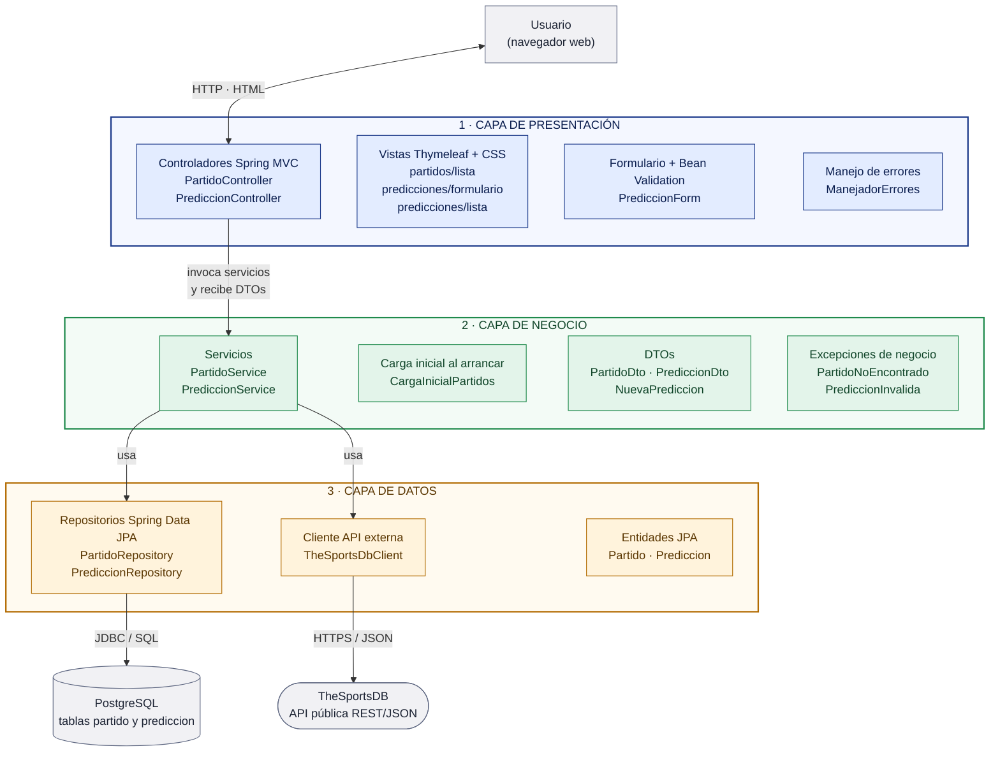

# LAB5_1 – Champions League: Partidos y Predicciones

Aplicación web en **arquitectura de 3 capas** (Presentación, Lógica de Negocio y Acceso a Datos) para la gestión de partidos de la UEFA Champions League. Consume la API pública [TheSportsDB](https://www.thesportsdb.com/), guarda los partidos en PostgreSQL y permite registrar y consultar predicciones.

## Funcionalidades

| # | Requerimiento | Cómo se cumple |
|---|---|---|
| 1 | Consumir una API pública con información de partidos | Cliente HTTP de **TheSportsDB** (liga 4480, UEFA Champions League) |
| 2 | Al iniciar, almacenar los partidos en una BD relacional | Al arrancar se descargan las jornadas configuradas y se guardan en **PostgreSQL** (sin duplicados; los existentes se actualizan) |
| 3 | Mostrar el listado completo de partidos | Página **Partidos** (`/partidos`), con filtro por jornada |
| 4 | Registrar predicciones (ganador o empate y marcador estimado) | Botón **Predecir** en los partidos por jugar, que abre un formulario |
| 5 | Almacenar las predicciones asociadas a su partido | Tabla `prediccion` con clave foránea `partido_id` |
| 6 | Consultar todas las predicciones | Página **Predicciones** (`/predicciones`); cuando el partido termina, muestra el resultado real y si la predicción acertó |

## Tecnologías

- **Java 21** y **Spring Boot 4.1** (Spring MVC, Spring Data JPA, Bean Validation)
- **Thymeleaf** para las vistas
- **PostgreSQL** como base de datos relacional
- **Maven Wrapper** (`mvnw`): no hace falta instalar Maven
- API pública **TheSportsDB** (clave gratuita `123`)

## Arquitectura en capas



Organización en paquetes:

```
com.lab5.champions
├── presentation      → Capa de PRESENTACIÓN
│   ├── controller    (PartidoController, PrediccionController, ManejadorErrores)
│   └── form          (PrediccionForm: datos y validación del formulario)
├── business          → Capa de LÓGICA DE NEGOCIO
│   ├── service       (PartidoService, PrediccionService: reglas de la aplicación)
│   ├── dto           (PartidoDto, PrediccionDto, NuevaPrediccion)
│   ├── exception     (PartidoNoEncontradoException, PrediccionInvalidaException)
│   └── CargaInicialPartidos (sincroniza los partidos al iniciar)
└── data              → Capa de ACCESO A DATOS
    ├── entity        (Partido, Prediccion, ResultadoPrediccion)
    ├── repository    (PartidoRepository, PrediccionRepository: Spring Data JPA)
    └── external      (TheSportsDbClient, EventoApi, RespuestaEventos: API pública)
```

Las dependencias van en un solo sentido: **Presentación → Negocio → Datos**. La presentación nunca accede a entidades, repositorios ni a la API; recibe DTOs de la capa de negocio.

📄 Documentación detallada:

- **[docs/arquitectura.md](docs/arquitectura.md)**: responsabilidades y tecnologías de cada capa, reglas de dependencia y decisiones de diseño.
- **[docs/flujo-de-datos.md](docs/flujo-de-datos.md)**: modelo de datos, transformación de los datos entre capas y diagramas de secuencia de cada caso de uso (carga inicial, listado, registro y consulta de predicciones).

### Reglas de negocio de las predicciones

- Solo se puede predecir un partido **por jugar** (estado `NS` y fecha futura).
- El **ganador indicado debe coincidir con el marcador**: "Gana local" requiere más goles del local, "Empate" el mismo número de goles, etc.
- Autor obligatorio y goles entre 0 y 20.
- Cuando el partido finaliza, la predicción se evalúa como **Marcador exacto**, **Acertó resultado** o **Falló**.

## Instalación y ejecución local

### Requisitos previos

- **JDK 21** (por ejemplo, [Eclipse Temurin](https://adoptium.net/)); comprobar con `java -version`
- **PostgreSQL** 14 o superior (probado con PostgreSQL 18)
- **Git**
- Conexión a Internet (para descargar dependencias y consultar la API)

### 1. Clonar el repositorio

```bash
git clone https://github.com/fabio2152/LAB5_1.git
cd LAB5_1
```

### 2. Crear la base de datos

```bash
psql -U postgres -c "CREATE DATABASE champions;"
```

No hace falta crear las tablas: Hibernate las genera al iniciar la aplicación.

### 3. Configurar las variables de entorno

Como mínimo, la contraseña de PostgreSQL. El resto tiene valores por defecto (ver tabla más abajo).

**Windows (PowerShell)**, solo para la terminal actual:

```powershell
$env:DB_PASSWORD = "tu_contraseña"
```

**Linux / macOS (bash)**:

```bash
export DB_PASSWORD="tu_contraseña"
```

### 4. Ejecutar la aplicación

**Windows:**

```powershell
.\mvnw.cmd spring-boot:run
```

**Linux / macOS:**

```bash
./mvnw spring-boot:run
```

La primera vez el wrapper descarga Maven y las dependencias. Al iniciar, el log muestra la carga de partidos:

```
TheSportsDB: jornada 1 de 2026-2027 -> 46 partidos
...
Sincronización completa: 220 partidos guardados (220 en total en la BD)
```

### 5. Abrir la aplicación

👉 **http://localhost:8080**

| Página | Ruta | Descripción |
|---|---|---|
| Partidos | `/partidos` | Listado completo de partidos (filtro `?jornada=N`) |
| Nueva predicción | `/partidos/{id}/predicciones/nueva` | Formulario (botón **Predecir**) |
| Predicciones | `/predicciones` | Todas las predicciones registradas |

### Generar el JAR ejecutable (opcional)

```bash
./mvnw clean package
java -jar target/champions-0.0.1-SNAPSHOT.jar
```

En Windows se usa `.\mvnw.cmd clean package`.

## Variables de entorno

| Variable | Valor por defecto | Descripción |
|---|---|---|
| `DB_HOST` | `localhost` | Host de PostgreSQL |
| `DB_PORT` | `5432` | Puerto de PostgreSQL |
| `DB_NAME` | `champions` | Nombre de la base de datos |
| `DB_USER` | `postgres` | Usuario de PostgreSQL |
| `DB_PASSWORD` | *(vacío)* | Contraseña de PostgreSQL |
| `APP_PORT` | `8080` | Puerto HTTP de la aplicación |
| `APP_TIMEZONE` | `America/Lima` | Zona horaria en que se muestran las fechas (en la BD se guardan en UTC) |
| `SPORTSDB_API_KEY` | `123` | Clave de TheSportsDB (`123` es la clave gratuita pública) |
| `SPORTSDB_LEAGUE_ID` | `4480` | Liga a consultar (4480 = UEFA Champions League) |
| `SPORTSDB_SEASON` | `2026-2027` | Temporada |
| `SPORTSDB_ROUNDS` | `1,2,3,4,5,6,7,8` | Jornadas a descargar |
| `SPORTSDB_DELAY_MS` | `3000` | Pausa entre llamadas a la API (ms) |
| `SPORTSDB_SYNC_ON_STARTUP` | `true` | Sincronizar partidos al iniciar |

## Notas sobre la API TheSportsDB

- Se usa el endpoint `eventsround.php` (partidos por jornada), porque con la clave gratuita `eventsseason.php` solo devuelve 15 partidos.
- La clave gratuita **limita las peticiones por minuto**. Si se reinicia la aplicación muchas veces seguidas, la API puede bloquear temporalmente (HTTP 429). La aplicación reintenta, omite la jornada si sigue fallando y **arranca igual** con los partidos ya guardados.
- Durante el desarrollo se puede arrancar sin consultar la API con `SPORTSDB_SYNC_ON_STARTUP=false`.

## Estructura del repositorio

```
LAB5_1/
├── docs/
│   ├── arquitectura.md          Diagrama y descripción de la arquitectura
│   └── flujo-de-datos.md        Documentación del flujo de datos
├── src/main/java/com/lab5/champions/
│   ├── presentation/            Capa de presentación
│   ├── business/                Capa de lógica de negocio
│   ├── data/                    Capa de acceso a datos
│   └── ChampionsApplication.java
├── src/main/resources/
│   ├── templates/               Vistas Thymeleaf
│   ├── static/css/              Estilos
│   └── application.properties   Configuración (lee las variables de entorno)
├── mvnw, mvnw.cmd, .mvn/        Maven Wrapper
└── pom.xml
```
