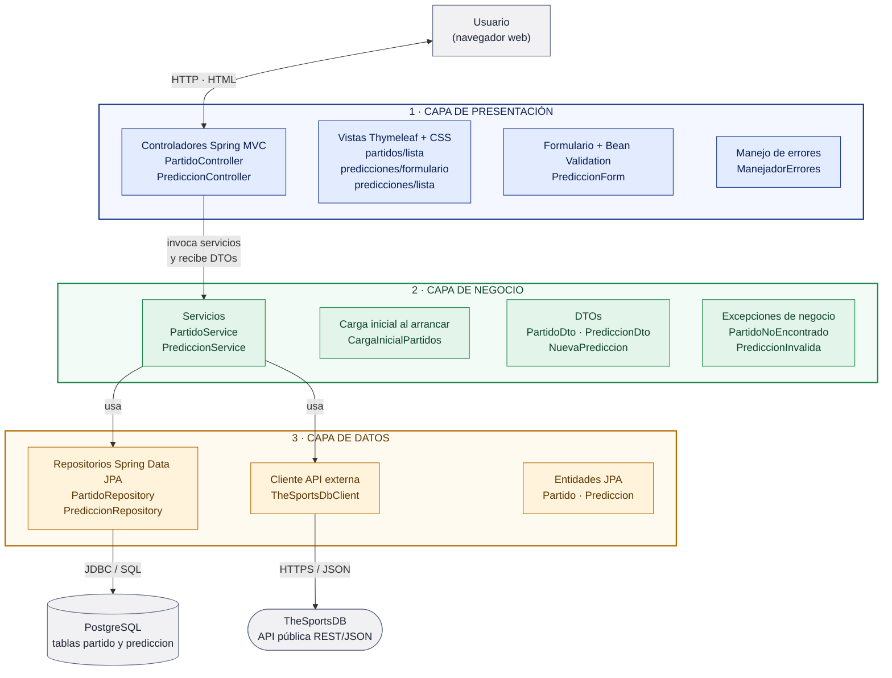

# Arquitectura de la aplicación

La aplicación es una aplicación web monolítica en **Spring Boot** organizada en **tres capas lógicas**: Presentación, Lógica de Negocio y Acceso a Datos. Cada capa es un paquete Java independiente y solo se comunica con la capa inmediatamente inferior.

## Diagrama de arquitectura



**Cómo leer el diagrama:** las flechas indican quién llama a quién. Las peticiones del usuario entran por los controladores (capa 1), que delegan en los servicios (capa 2). Los servicios usan los repositorios y el cliente HTTP (capa 3), que son los únicos que hablan con PostgreSQL y con la API externa.

## Responsabilidades de cada capa

### 1. Capa de Presentación (`com.lab5.champions.presentation`)

Recibe las peticiones HTTP del navegador y devuelve páginas HTML. No contiene reglas de negocio ni accede a la base de datos.

| Componente | Responsabilidad |
|---|---|
| `PartidoController` | `GET /partidos`: listado de partidos con filtro por jornada |
| `PrediccionController` | Formulario y registro de predicciones (`GET`/`POST /partidos/{id}/predicciones`) y consulta (`GET /predicciones`) |
| `PrediccionForm` | Datos del formulario con validación de formato (Bean Validation) |
| `ManejadorErrores` | Traduce las excepciones de negocio a respuestas web (página 404) |
| Vistas Thymeleaf | `partidos/lista`, `predicciones/formulario`, `predicciones/lista`, `error/no-encontrado` |

**Tecnologías:** Spring MVC, Thymeleaf, Jakarta Bean Validation, HTML y CSS.

### 2. Capa de Lógica de Negocio (`com.lab5.champions.business`)

Contiene las reglas de la aplicación y coordina el acceso a los datos.

| Componente | Responsabilidad |
|---|---|
| `PartidoService` | Sincroniza los partidos con la API (sin duplicar), lista los partidos y decide si un partido admite predicciones |
| `PrediccionService` | Valida y registra predicciones; las lista y las evalúa contra el resultado real |
| `CargaInicialPartidos` | Lanza la sincronización al iniciar la aplicación (`ApplicationRunner`) |
| DTOs (`PartidoDto`, `PrediccionDto`, `NuevaPrediccion`) | Objetos que intercambia con la presentación, para no exponer las entidades JPA |
| Excepciones (`PartidoNoEncontradoException`, `PrediccionInvalidaException`) | Errores de negocio que la presentación muestra al usuario |

**Reglas de negocio:**

- Solo se predicen partidos **por jugar** (estado `NS` y fecha futura).
- El **ganador indicado debe coincidir con el marcador** estimado.
- Goles entre 0 y 20 y autor obligatorio.
- Evaluación al finalizar el partido: *Marcador exacto*, *Acertó resultado* o *Falló*.
- Las fechas se guardan en UTC y se convierten a la zona horaria configurada al mostrarlas.

**Tecnologías:** Spring (`@Service`, `@Transactional`).

### 3. Capa de Acceso a Datos (`com.lab5.champions.data`)

Es la única capa que conoce las fuentes de datos: la base de datos relacional y la API externa.

| Componente | Responsabilidad |
|---|---|
| `Partido`, `Prediccion`, `ResultadoPrediccion` | Entidades JPA mapeadas a las tablas `partido` y `prediccion` (relación 1 a N) |
| `PartidoRepository`, `PrediccionRepository` | Consultas a PostgreSQL con Spring Data JPA |
| `TheSportsDbClient` | Cliente HTTP de TheSportsDB: descarga los partidos por jornada, con pausas y reintentos ante el límite de peticiones |
| `EventoApi`, `RespuestaEventos` | Mapeo del JSON que devuelve la API |

**Tecnologías:** Spring Data JPA / Hibernate, driver JDBC de PostgreSQL, `RestClient` de Spring y Jackson.

### Sistemas externos

| Sistema | Uso |
|---|---|
| **PostgreSQL** | Base de datos relacional persistente (tablas `partido` y `prediccion`) |
| **TheSportsDB** | API pública REST/JSON con los partidos de la UEFA Champions League (liga 4480) |

## Reglas de dependencia

```
Presentación  ──►  Negocio  ──►  Datos  ──►  PostgreSQL / TheSportsDB
```

- La **presentación** solo importa clases de `business` (servicios, DTOs y excepciones). Nunca usa entidades, repositorios ni el cliente HTTP.
- El **negocio** usa la capa de datos y transforma las entidades en DTOs antes de devolverlas.
- Los **datos** no dependen de ninguna otra capa.

Así, se puede cambiar una capa sin tocar las demás. Por ejemplo, otra API de partidos solo afecta a `TheSportsDbClient`; otra interfaz (una API REST o una app móvil) solo afecta a la presentación.

## Decisiones de diseño

| Decisión | Motivo |
|---|---|
| DTOs entre negocio y presentación | Las vistas no dependen del modelo de persistencia y reciben los datos ya preparados (hora local, textos de estado) |
| Validación en dos niveles | El formato se valida en el formulario; las reglas de negocio, en los servicios. Si se agrega otra interfaz, las reglas siguen aplicándose |
| `id_externo` único en `partido` | Sincronizar varias veces actualiza los partidos (marcador, estado) en lugar de duplicarlos |
| Fechas en UTC en la base de datos | Mismo resultado sin importar la zona horaria del servidor (local, Docker o AWS) |
| Configuración por variables de entorno | La misma aplicación se ejecuta en local, en Docker o en la nube sin cambiar el código |
| Pausas y reintentos en el cliente HTTP | La clave gratuita de TheSportsDB limita las peticiones por minuto |
| La app arranca aunque la API falle | Los partidos ya guardados siguen disponibles |

El recorrido de los datos en cada caso de uso está en [flujo-de-datos.md](flujo-de-datos.md).
