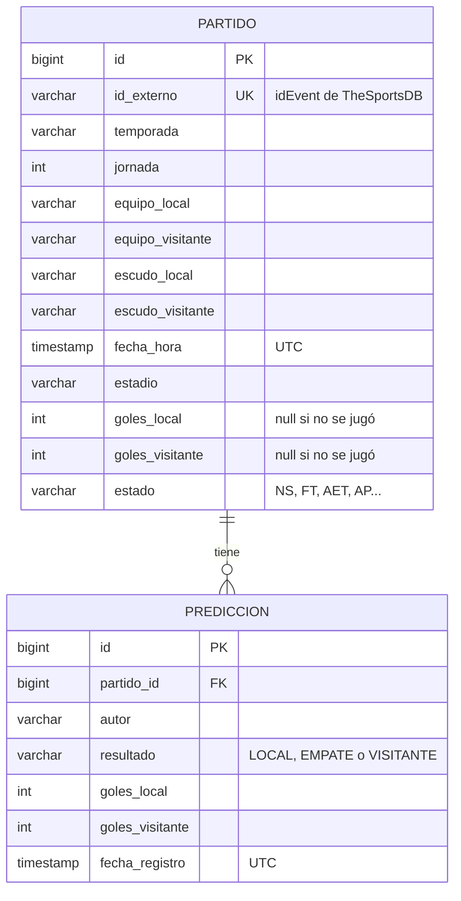
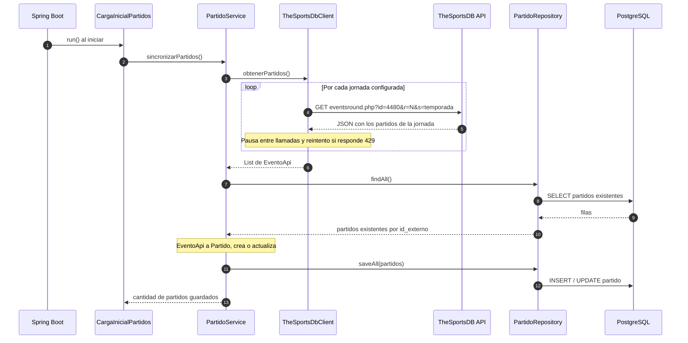
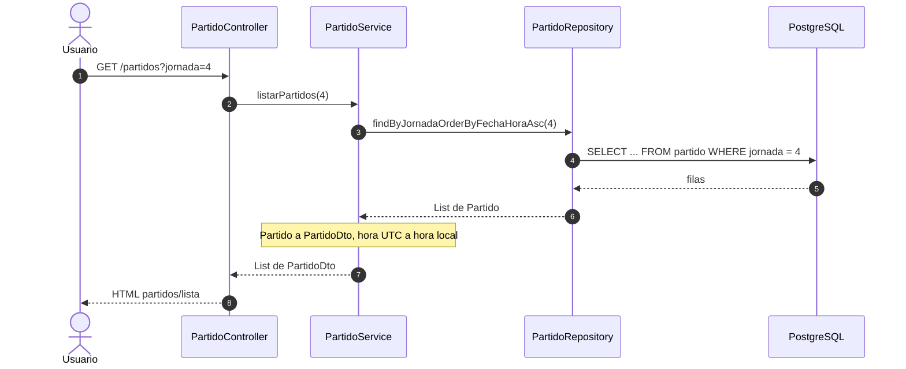
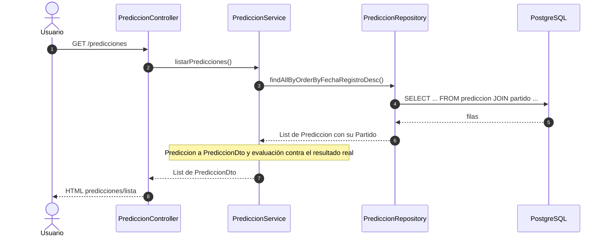

# Flujo de datos

Este documento describe cómo viajan los datos entre las tres capas de la aplicación en cada caso de uso.

## Capas y regla de dependencia

| Capa | Paquete | Responsabilidad |
|---|---|---|
| **Presentación** | `com.lab5.champions.presentation` | Controladores Spring MVC, formularios y vistas Thymeleaf. Recibe las peticiones HTTP y muestra los resultados. |
| **Lógica de negocio** | `com.lab5.champions.business` | Servicios con las reglas de la aplicación, DTOs y excepciones de negocio. |
| **Acceso a datos** | `com.lab5.champions.data` | Entidades JPA, repositorios (PostgreSQL) y cliente HTTP de la API pública TheSportsDB. |

Las dependencias van en un solo sentido: **Presentación → Negocio → Datos**.

- La presentación solo conoce servicios, DTOs y excepciones de la capa de negocio. Nunca usa entidades, repositorios ni el cliente de la API.
- La capa de negocio convierte las entidades en DTOs antes de devolverlas, de modo que las entidades JPA no salen de las capas inferiores.
- La capa de datos no depende de ninguna otra capa.

## Modelo de datos



- Las tablas las crea Hibernate a partir de las entidades `Partido` y `Prediccion` (`spring.jpa.hibernate.ddl-auto=update`).
- `id_externo` es único: evita duplicar un partido cuando se vuelve a sincronizar.
- Todas las fechas se guardan en **UTC** y se convierten a la zona horaria configurada (`APP_TIMEZONE`, por defecto `America/Lima`) solo al mostrarlas.

## Transformación de los datos entre capas

| Paso | Capa | Forma del dato |
|---|---|---|
| 1 | Externa | JSON de TheSportsDB (`{"events": [...]}`, todos los valores como texto) |
| 2 | Datos | `RespuestaEventos` / `EventoApi` (records Java) |
| 3 | Negocio | `Partido` (entidad JPA) con tipos convertidos: `Integer`, `LocalDateTime` en UTC |
| 4 | Datos | Fila en la tabla `partido` (PostgreSQL) |
| 5 | Negocio | `PartidoDto` / `PrediccionDto` con la fecha en hora local y textos listos para mostrar |
| 6 | Presentación | HTML generado por Thymeleaf |

En sentido contrario (registro de predicciones): formulario HTML → `PrediccionForm` → `NuevaPrediccion` → entidad `Prediccion` → fila en la tabla `prediccion`.

---

## Flujo 1: carga de partidos al iniciar la aplicación

Requerimientos 1 y 2: consumir la API pública y almacenar los partidos en la base de datos.

1. Al terminar de arrancar Spring Boot, `CargaInicialPartidos` (un `ApplicationRunner`) llama a `PartidoService.sincronizarPartidos()`.
2. `PartidoService` pide los partidos a `TheSportsDbClient`.
3. El cliente consulta `eventsround.php` jornada por jornada (`SPORTSDB_ROUNDS`, por defecto 1 a 8) para la liga 4480 (UEFA Champions League) y la temporada `SPORTSDB_SEASON`.
   - Entre llamadas espera `SPORTSDB_DELAY_MS` (3 s) para respetar el límite de la clave gratuita.
   - Si la API responde 429 o corta la conexión, reintenta hasta 2 veces. Si la jornada sigue fallando, la omite y continúa con las demás.
4. `PartidoService` convierte cada `EventoApi` en una entidad `Partido`. Si ya existe un partido con el mismo `id_externo`, lo actualiza (marcador, estado, fecha) en lugar de crear otro.
5. `PartidoRepository.saveAll()` guarda todos los partidos en PostgreSQL.
6. Si la API no está disponible, el error se registra en el log y la aplicación arranca igual con los partidos que ya estaban guardados.

La carga se puede desactivar con `SPORTSDB_SYNC_ON_STARTUP=false`.



## Flujo 2: listado de partidos

Requerimiento 3: mostrar el listado completo de partidos almacenados.

1. El usuario abre `/partidos` (opcionalmente `?jornada=N` para filtrar).
2. `PartidoController` llama a `PartidoService.listarPartidos(jornada)` y `listarJornadas()`.
3. `PartidoService` consulta `PartidoRepository` (ordenado por fecha) y convierte cada entidad en `PartidoDto`:
   - la fecha pasa de UTC a la hora local;
   - el código de estado (`NS`, `FT`...) se traduce a texto ("Por jugar", "Finalizado"...);
   - se calcula si el partido admite predicciones (estado `NS` y fecha futura).
4. La vista `partidos/lista.html` muestra la tabla y el botón **Predecir** en los partidos que lo admiten.



## Flujo 3: registrar una predicción

Requerimientos 4 y 5: registrar la predicción (ganador o empate y marcador estimado) y almacenarla asociada a su partido.

1. El usuario pulsa **Predecir** y se muestra `predicciones/formulario.html` (`GET /partidos/{id}/predicciones/nueva`).
2. Al enviar (`POST /partidos/{id}/predicciones`), Spring vincula los datos a `PrediccionForm` y aplica Bean Validation: autor obligatorio (máx. 80 caracteres), resultado `LOCAL`/`EMPATE`/`VISITANTE` y goles de 0 a 20. Si hay errores, se vuelve a mostrar el formulario con los mensajes.
3. `PrediccionController` construye un `NuevaPrediccion` y llama a `PrediccionService.registrar()`.
4. `PrediccionService` aplica las reglas de negocio:
   - el partido debe existir (si no, `PartidoNoEncontradoException` → página 404);
   - el partido debe estar por jugar (estado `NS` y fecha futura);
   - el ganador indicado debe coincidir con el marcador estimado (por ejemplo, "Empate" exige el mismo número de goles).

   Si una regla no se cumple lanza `PrediccionInvalidaException` y el formulario muestra el mensaje.
5. Si todo es válido, crea la entidad `Prediccion` asociada al `Partido` (clave foránea `partido_id`), la guarda con la fecha de registro en UTC y redirige al listado con un mensaje de confirmación.

```mermaid
sequenceDiagram
    autonumber
    actor U as Usuario
    participant PC as PrediccionController
    participant PRS as PrediccionService
    participant PAR as PartidoRepository
    participant PRR as PrediccionRepository
    participant DB as PostgreSQL

    U->>PC: POST /partidos/134/predicciones (autor, resultado, goles)
    Note over PC: Bean Validation sobre PrediccionForm
    alt Datos con formato inválido
        PC-->>U: Formulario con errores por campo
    else Formato correcto
        PC->>PRS: registrar(NuevaPrediccion)
        PRS->>PAR: findById(134)
        PAR->>DB: SELECT ... FROM partido WHERE id = 134
        DB-->>PAR: fila
        PAR-->>PRS: Partido
        alt Partido ya iniciado o ganador incoherente con el marcador
            PRS-->>PC: PrediccionInvalidaException
            PC-->>U: Formulario con el mensaje de error
        else Predicción válida
            PRS->>PRR: save(Prediccion con su Partido)
            PRR->>DB: INSERT INTO prediccion (partido_id, ...)
            PRS-->>PC: id de la predicción
            PC-->>U: Redirección a /partidos con mensaje de éxito
        end
    end
```

## Flujo 4: consultar las predicciones

Requerimiento 6: consultar todas las predicciones registradas.

1. El usuario abre `/predicciones`.
2. `PrediccionController` llama a `PrediccionService.listarPredicciones()`.
3. `PrediccionRepository.findAllByOrderByFechaRegistroDesc()` trae las predicciones junto con su partido en **una sola consulta** (`@EntityGraph`, JOIN), de la más reciente a la más antigua.
4. `PrediccionService` convierte cada una en `PrediccionDto`:
   - fechas en hora local;
   - pronóstico como texto ("Gana Barcelona", "Empate");
   - si el partido ya finalizó, el resultado real y la evaluación: **Marcador exacto**, **Acertó resultado** o **Falló**. Si no, **Pendiente**.
5. La vista `predicciones/lista.html` muestra la tabla.



## Manejo de errores

| Situación | Dónde se detecta | Qué ve el usuario |
|---|---|---|
| API caída o límite de peticiones | `TheSportsDbClient` (reintenta) y `CargaInicialPartidos` | Nada: la app arranca con los partidos ya guardados; el detalle queda en el log |
| Campo vacío o fuera de rango | Bean Validation en `PrediccionForm` | Mensaje bajo el campo del formulario |
| Partido ya iniciado o marcador incoherente | `PrediccionService` → `PrediccionInvalidaException` | Mensaje en la parte superior del formulario |
| Partido inexistente | `PartidoService` / `PrediccionService` → `PartidoNoEncontradoException` | Página 404 "No encontrado" (`ManejadorErrores`) |
